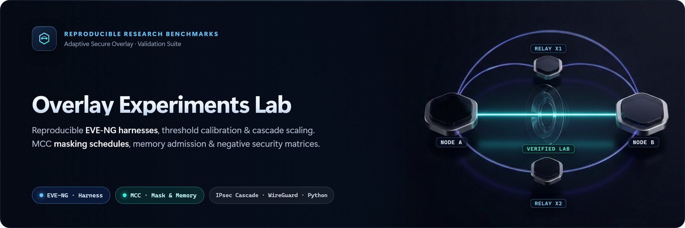

# Adaptive Overlay Experiments

   

Reproducible research benchmarks, EVE-NG test harnesses, statistical validation scripts, and telemetry datasets supporting the doctoral research on **Adaptive Secure Overlay**.

## Experiment Suites

| Directory | Focus | Highlights |
| :--- | :--- | :--- |
| `remarks-closure-20260903/` | Core IPsec/Cascade & Trust Registry validation | 4 series: threshold calibration, cascade hop scaling, trust-registry negative matrix, concurrent starts (`run_experiments.py`, `validate_results.py`, CSV/JSON results) |
| `wireguard-eve/` | WireGuard overlay EVE-NG test harness | `harness.py`, fail-closed `safe_gate.py`, manifest template, unit tests, closure reports |
| `mcc-mask-schedule-20261022/` | MCC masking schedule, UDP buffering & memory admission | `admission.py`, `capacity_gate.py`, `memory_policy.py`, `mask_audit.py`, `report_mask.py`, `report_udp.py`, unit tests (`test_udp.py`, `test_memory.py`) |
| `mcc-memory-admission-audit-20261022/` | Memory admission audit | `read_memory.py` and host commit-consumer telemetry snapshot |
| `wan-2x2-benchmark-20261126/` | Live 4-node Dual-NAT WAN `2×2` matrix (`{Python, Rust} × {IPsec, WireGuard}`) | Full anonymized dataset (`results.json`), `README.md` analysis, zero-dependency `audit_wan_pcap.py` (Ethernet / Linux SLL v1 / SLL v2) and unit tests (`test_audit_wan_pcap.py`) |
